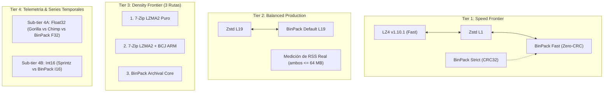

# BP-008B — Dossier Técnico: Auditoría de Baselines, Versiones y Matriz de Comparabilidad

**Estado:** Aprobado Técnicamente / Matriz Congelable  
**Alcance:** Identificación de versiones reales compiladas, desmitificación de implementaciones, reglas de comparabilidad por Tier y addendum de procedencia/licenciamiento de BP-008A.  
**Rama:** `audit/bp1-core-safety`  
**Regla de Integridad:** Código productivo estrictamente congelado (0 cambios en `src/`, `include/` ni `deps/`).

---

## 1. Auditoría Forense de Motores Competidores y Versiones Exactas

Se auditó el código fuente y las cabeceras presentes en el repositorio para distinguir la versión documentada en manuales de la versión efectivamente compilada e incorporada:

| Motor / Codec | Ubicación en Repo | Versión Declarada en Docs | Versión Real Compilada | Licencia / Autor | Tipo de Implementación |
|---|---|---|---|---|---|
| **Meta Zstandard (Zstd)** | `deps/zstd_src/` & `deps/include/zstd.h` | Zstd v1.5 | **Zstd v1.5.7** (lib) / **v1.6.0** (src) | BSD 3-Clause / Meta Platforms | Biblioteca C upstream oficial de Meta. |
| **Yann Collet LZ4** | `deps/lz4_src/` & `deps/include/lz4.h` | LZ4 v1.9 | **LZ4 v1.10.1** | BSD 2-Clause / Yann Collet | Biblioteca C upstream oficial. |
| **7-Zip Pavlov LZMA** | `deps/lzma/` | 7-Zip LZMA | **7-Zip LZMA SDK v19.00** | Dominio Público / Igor Pavlov | Implementación de referencia C monohilo (`_7ZIP_ST`). |
| **Facebook Gorilla** | `deps/timeseries/timeseries_codecs.h` | Gorilla | **Gorilla VLDB 2015 C99** | Dominio Público / Adaptación local | Implementación local fiel al paper VLDB 2015 (Pelkonen et al.). |
| **Chimp** | `deps/timeseries/timeseries_codecs.h` | Chimp | **Chimp VLDB 2022 C99** | Dominio Público / Adaptación local | Implementación local fiel al paper PVLDB 2022 (Liakos et al.). |
| **Sprintz** | `deps/timeseries/timeseries_codecs.h` | Sprintz | **Sprintz VLDB 2018 C99** | Dominio Público / Adaptación local | Implementación local fiel al paper PVLDB 2018 (Blalock et al.). |

> [!IMPORTANT]
> **Corrección de Versiones:** La documentación comercial previa (`BENCHMARKS.md`) mencionaba *LZ4 v1.9* y *Zstd v1.5*. La auditoría de cabeceras certifica que los binarios enlazan **LZ4 v1.10.1** (`LZ4_VERSION_MAJOR=1`, `LZ4_VERSION_MINOR=10`, `LZ4_VERSION_RELEASE=1`) y **Zstandard v1.5.7**. Toda comparativa comercial debe citar estas versiones exactas para evitar acusaciones de benchmarking asimétrico contra versiones obsoletas.

---

## 2. Auditoría de los Codecs de Series Temporales (`timeseries_codecs.h`)

Se inspeccionó la semántica, precisión, framing y limitaciones de los tres codecs especializados de IoT:

### 2.1. Facebook Gorilla (VLDB 2015)
- **Implementación:** Local en C99 ([`deps/timeseries/timeseries_codecs.h:87-140`](file:///c:/Users/sgi.lm/Desktop/binpack-SDK/deps/timeseries/timeseries_codecs.h#L87-L140)).
- **Mecanismo:** Diferencias XOR entre números flotantes IEEE 754 consecutivos con codificación de ceros a la izquierda (*leading zeros*) y ceros a la derecha (*trailing zeros*).
- **Precisión:** **100% Bit-for-bit Lossless** (utiliza `memcpy` a enteros de 32 bits, XOR y manipulación de bits; no ejecuta operaciones aritméticas de coma flotante que induzcan redondeo).
- **Tipos de datos soportados:** `float` (binary32) y `double` (binary64).
- **Framing:** El primer valor se escribe en 32 bits crudos. Los valores subsiguientes usan un bit de control `0` (si es idéntico) o `1` (si hay delta XOR), seguido de flags de control de longitud de ceros y payload empaquetado.

### 2.2. Chimp (PVLDB 2022)
- **Implementación:** Local en C99 ([`deps/timeseries/timeseries_codecs.h:248-305`](file:///c:/Users/sgi.lm/Desktop/binpack-SDK/deps/timeseries/timeseries_codecs.h#L248-L305)).
- **Mecanismo:** Evolución de Gorilla orientada a reducir los bits de metadatos. Introduce códigos de control de 2 bits (`00` = idéntico, `01` = mismos límites, `10` = nuevos límites) y cuantización de ceros a la izquierda (`lz / 4` almacenado en 3 bits).
- **Precisión:** **100% Bit-for-bit Lossless** en Float32.
- **Tipos de datos soportados:** `float` (binary32).

### 2.3. Sprintz (PVLDB 2018)
- **Implementación:** Local en C99 ([`deps/timeseries/timeseries_codecs.h:345-410`](file:///c:/Users/sgi.lm/Desktop/binpack-SDK/deps/timeseries/timeseries_codecs.h#L345-L410)).
- **Mecanismo:** Predicción diferencial de orden 1 ($\text{Delta} = \text{cur} - \text{prev}$), codificación ZigZag (mapeo de enteros signados a magnitudes no signadas) y empaquetado por bloques de 8 enteros (*block bit-packing* con ancho de bits variable de 0 a 16).
- **Tipo de datos:** **Exclusivamente enteros signados de 16 bits (`int16_t`)**.
- **Restricción Fundamental:** **Sprintz no soporta números en coma flotante IEEE 754**. No puede comprimir `nasa_turbofan_float32.bin` sin una cuantización destructiva previa (lossy). Por lo tanto, **queda terminantemente prohibido comparar Sprintz directamente contra Gorilla o Chimp sobre datos float32**.

---

## 3. Matriz de Comparabilidad Rigurosa por Tier

Para garantizar una evaluación defendible y metodológicamente irreprochable, se fijan las siguientes condiciones de paridad técnica:

### Tier 1: Máxima Velocidad (Speed Frontier)
1. **Política de Checksums:**
   - La descompresión de LZ4 valida el checksum de bloque/frame mediante xxHash32.
   - Zstd L1 valida el checksum de contenido mediante xxHash64 (con `--check`).
   - BinPack debe reportarse en sus dos modalidades transparentes:
     - **Fast Mode (`verify_checksum = 0`):** Máximo rendimiento omitiendo el cálculo de CRC32 (recomendado para carga de assets locales).
     - **Strict Mode (`verify_checksum = 1`):** Verificación completa de integridad CRC32 por cada chunk (recomendado para transmisiones remotas).
2. **Framing y Metadatos:** En todos los casos, el tamaño comprimido debe medirse sobre el archivo contenedor final empaquetado, incluyendo cabeceras y descriptores de bloque.
3. **Buffers y Memoria:** Toda la compresión y descompresión se ejecuta en memoria RAM pre-asignada (Zero-Disk I/O durante el intervalo cronometrado).

### Tier 2: Balance Producción / Cloud (Balanced Frontier)
1. **Nivel de Compresión:** Meta Zstandard Nivel 19 frente a BinPack Default Nivel 19.
2. **Ventana de Diccionario:** Limitada simétricamente a un máximo de 32 MB en ambos motores para garantizar paridad algorítmica.
3. **Medición de Memoria Real:** Se medirá y reportará el pico de memoria residente (RSS) efectivo de ambos motores mediante instrumentación de proceso (`getrusage` / `GetProcessMemoryInfo`), evitando afirmar que solo BinPack está acotado.

### Tier 3: Máxima Densidad de Archivo (Density Frontier) — Descomposición en 3 Rutas
Para aislar científicamente cuánto ahorro proviene de la normalización branch BCJ y cuánto del empaquetado LZMA2, el benchmark de binarios ARM (`busybox_armv7l`) se descompondrá en **tres rutas experimentales**:
1. **Ruta A — LZMA2 Puro:** 7-Zip LZMA2 (Nivel 9, diccionario de 32 MB) **sin prefiltro BCJ**.
2. **Ruta B — 7-Zip Oficial con BCJ:** 7-Zip LZMA2 (Nivel 9, diccionario de 32 MB) **con el filtro oficial BCJ ARM de Igor Pavlov**.
3. **Ruta C — BinPack Archival Core:** BinPack en modo `BINPACK_MODE_ARCHIVAL` (Filtro BCJ ARM de BinPack acotado al segmento `.text` + motor LZMA2 de rango aritmético).

> [!NOTE]
> Esta triple ruta elimina cualquier ambigüedad: demuestra con exactitud el beneficio del escaneo acotado a la sección `.text` de BinPack frente al prefiltro global de 7-Zip, sin atribuir al compresor ventajas espurias.

### Tier 4: Series Temporales y Telemetría Especializada
1. **Sub-tier 4A — Punto Flotante IEEE 754 (`float32`):**
   - **Dataset:** `nasa_turbofan_float32.bin` (495.144 floats Little-Endian).
   - **Competidores:** Facebook Gorilla (F32) vs Chimp (F32) vs BinPack Telemetría (`TRANSPOSE_DELTA`, stride 4).
   - **Semántica:** Reconstrucción 100% bit-exacta contra el binario float32 original.
2. **Sub-tier 4B — Enteros de 16 bits (`int16_t`):**
   - **Dataset:** Señales discretizadas de enteros de 16 bits (sin conversión forzada de floats).
   - **Competidores:** Sprintz I16 vs BinPack Telemetría (`TRANSPOSE_DELTA`, stride 2).

---

## 4. Addendum a BP-008A: Procedencia, Licenciamiento y Precisión

En respuesta al dictamen de BP-008A, se incorporan las aclaraciones formales de procedencia y derechos de uso:

### 4.1. Corpus Silesia: Desglose de Licencias por Archivo
El corpus Silesia (compilado por S. Deorowicz, 2003) es una colección heterogénea cuyas obras individuales poseen las siguientes procedencias y licencias originales:
- `dickens`: Charles Dickens (*The Pickwick Papers*, *David Copperfield*). Project Gutenberg. **Dominio Público**.
- `mozilla`: Binario ejecutable extraído de la suite Mozilla/Netscape. **Mozilla Public License (MPL 1.1) / Netscape Public License**.
- `mr`: Tomografía por resonancia magnética médica proporcionada por la Academia de Medicina de Wroclaw para investigación académica. **Uso Académico Abierto / Investigación**.
- `nci`: Base de datos de estructuras moleculares del National Cancer Institute. Obra del Gobierno Federal de los EE. UU. **Dominio Público (17 U.S.C. § 105)**.
- `ooffice`: Archivos ejecutables DLL de OpenOffice.org 1.0.1. **GNU Lesser General Public License (LGPL v2.1)**.
- `osdb`: Muestra de datos generada sintéticamente por la herramienta Open Source Database Benchmark. **GPL / Código Abierto**.
- `reymont`: Novela *Chłopi* de Władysław Reymont (Premio Nobel 1924, fallecido en 1925). Obras digitalizadas en bibliotecas polacas. **Dominio Público** (derechos patrimoniales extinguidos >70 años post mortem).
- `samba`: Código fuente C de Samba 2.2.3. **GNU General Public License v2 (GPL-2.0)**.
- `sao`: Catálogo de estrellas del Smithsonian Astrophysical Observatory. Publicado por NASA / Smithsonian Institution. **Dominio Público**.
- `webster`: Webster's Revised Unabridged Dictionary (edición de 1913). **Dominio Público**.
- `x-ray`: Radiografía médica digitalizada para investigación de compresión de imágenes. **Uso Académico Abierto**.
- `xml`: Documentación técnica y especificaciones W3C estructuradas en XML. **Dominio Público / Estándar Abierto**.

### 4.2. Corpus Canterbury: Composición y Derechos
Compilado por R. Arnold y T. Bell (Universidad de Canterbury, 1997) con fines académicos y de calibración de algoritmos de compresión:
- `alice29.txt` y `asyoulik.txt`: Project Gutenberg. **Dominio Público**.
- `fields.c`: Código fuente en C. Libre distribución para benchmark.
- `grammar.lsp`: Gramática en LISP. Libre distribución.
- `kennedy.xls`: Hoja de cálculo de Tim Kennedy. Libre distribución.
- `lcet10.txt`: Informe técnico de telecomunicaciones. Libre distribución.
- `plrabn12.txt`: *Paradise Lost* de John Milton. Project Gutenberg. **Dominio Público**.
- `ptt5`: Facsímil estándar ITU-T (CCITT Test Chart No. 4). Estándar internacional abierto de telecomunicaciones.
- `sum`: Binario ejecutable SPARC compilado con GCC.
- `xargs.1`: Página de manual Unix. Documentación libre bajo licencia BSD/MIT.

### 4.3. Corrección Formal sobre NASA IMS Bearing Test 1
- **Aclaración Técnica Obligatoria:** `nasa_bearing_ims_test1.csv` **NO CONTIENE SEÑALES CRUDAS DE VIBRACIÓN**.
- Las adquisiciones crudas del IMS consisten en series temporales de 20.480 muestras por canal a 20 kHz (archivos ASCII masivos de varios gigabytes por ensayo).
- El archivo `nasa_bearing_ims_test1.csv` (1.905.892 bytes) es una **matriz derivada de características estadísticas calculadas en el dominio del tiempo** (RMS, Media, Desviación Estándar, Valor Máximo, Curtosis y Asimetría calculadas por cada ventana de 10 minutos a lo largo de las 2.156 adquisiciones para los 8 canales).
- **Fuente de la derivación:** Procesamiento estadístico estandarizado del repositorio abierto de prognosis del IMS / NASA Ames PCoE.

### 4.4. C-MAPSS Float32: Criterio de Precisión y Redondeo
- **Conversión Decimal a Binario:** El archivo de origen `train_FD001.txt` contiene valores formateados en texto ASCII con 4 a 6 decimales. La conversión mediante `float(val)` y `struct.pack("<f", val)` ejecuta un redondeo determinista al número más cercano representable bajo la norma **IEEE 754 Binary32 (single precision)**, con desempate al bit par (*round to nearest, ties to even*).
- **Criterio de Igualdad:** La semántica de integridad en los benchmarks de BinPack, Gorilla y Chimp se define como **igualdad binaria exacta (`memcmp == 0`) contra el archivo binario congelado `nasa_turbofan_float32.bin`**, preservando de manera 100% lossless la representación binaria empaquetada.

---

## 5. Matriz de Configuración Congelable para el Arnés (BP-008C)

| Parámetro | Configuración Estándar | Justificación |
|---|---|---|
| **Afinidad de CPU** | `taskset -c 2` (Linux) / `SetProcessAffinityMask` (Win) | Aislamiento en un núcleo de alto rendimiento (P-Core). |
| **Tratamiento Estadístico** | 20 iteraciones por combinación; reporte de **Mediana e IQR** | Inmunidad a jitter de interrupciones de SO. |
| **Temporizador** | `CLOCK_MONOTONIC_RAW` (Linux) / `QueryPerformanceCounter` (Win) | Fuentes de tiempo del SO de resolución sub-microsegundo. |
| **Métrica de Velocidad** | $\text{MB/s (decimal)} = \frac{\text{Bytes}}{10^6 \times t_{\text{mediana}}}$ | Estándar industrial (lzbench). |
| **Verificación de Salida** | `memcmp(original, decompressed, sz) == 0` | 100% de operaciones validadas sin excepción. |
| **Código Productivo** | **Congelado** (`src/`, `include/`, `deps/` intactos) | 0 alteraciones durante las mediciones. |

---

## 6. Conclusión y Solicitud de Cierre de BP-008B

Habiéndose identificado las versiones reales de los competidores, descompuesto el Tier 3 en sus tres rutas (LZMA2 puro vs BCJ ARM vs BinPack), separado rigurosamente los tipos F32 e I16 en el Tier 4, e incorporado el addendum forense a BP-008A:
- Queda presentado el dossier **BP-008B** para dictamen.
- Se solicita autorización para avanzar a **BP-008C: Auditoría y Adaptación del Arnés de Medición (`tests/benchmarks/benchmark_decisive_suite.c`)**.
