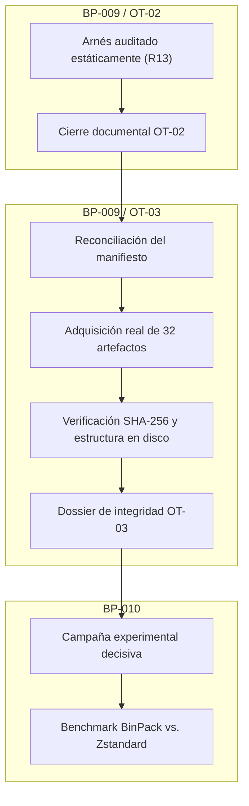

# Auditoría y Certificación del Arnés de Adquisición de Corpora — Hito BP-009 / OT-02 (Revisión Final R13)

**Expediente:** BP-009 / Orden de Trabajo 02 — Arnés de Adquisición, Verificación Criptográfica y Preparación de Corpora  
**Proyecto:** BinPack Enterprise SDK  
**Ramas:** `audit/bp009-r8-artifact` (código del artefacto) | `audit/bp1-core-safety` (expediente documental)  
**Commit Inmutable Certificado (R13):** [`682b63e9faf109afd45311eccc1dc8783755dcad`](https://github.com/Santirobm/binpack-SDK/commit/682b63e9faf109afd45311eccc1dc8783755dcad)  
**Git Blob SHA-1:** `4ce3ef0330b30d89d3cac152e4fad36834a84812`  
**Ruta del Artefacto en Repositorio:** `audit/bp009-r8-artifact/temp_prepare_corpus_bp009.ps1`  
**Fecha de Emisión del Dictamen:** 10 de Noviembre de 2026  
**Estado Administrativo:** **APROBADO Y CERRADO FORMALMENTE (OT-02)**  

---

## 1. Resumen Ejecutivo y Resolución de Cierre

El presente documento formaliza el cierre de la **Orden de Trabajo 02 (OT-02)** del hito **BP-009** del proyecto BinPack Enterprise SDK, estableciendo de forma auditable los alcances técnicos verificados y delimitando taxativamente las fases subsiguientes.

### 1.1 Dictamen Emitido por la Auditoría Independiente
- **Calificación:** **APROBADO — APTO PARA CIERRE FORMAL DE OT-02**
- **Fundamento Técnico:** La revisión R13 resuelve la última observación técnica pendiente de R12:
  1. La clase `BinPack.Audit.FaultStream` incorpora la propiedad de solo lectura `BytesDelivered`, junto con `BytesReadSoFar` y `MaxBytesBeforeThrow`, que permiten exponer y contrastar cuantitativamente los bytes efectivamente devueltos por `Read()` frente al límite configurado.
  2. El escenario `SC-12` (`Test-Scenario12-PostCreateNewFailureCleanup`) verifica de manera cuantitativa que el flujo entregó exactamente 1.024 bytes antes de detonar la excepción, comprobando simultáneamente que el archivo temporal `.tmp` fue eliminado, que el destino no fue promovido y que los descriptores de archivo quedaron liberados.
  3. El arnés implementa un banner dinámico vinculado a `$PSCommandPath` que inspecciona el archivo en ejecución para reflejar en el registro su tamaño, cantidad de líneas y cálculo SHA-256 en tiempo real.

### 1.2 Identidad Declarada por el Ejecutor y Contrastada Parcialmente por Auditoría

| Parámetro | Valor Declarado / Observado | Estado de Verificación por Auditoría Independiente |
| :--- | :--- | :--- |
| **Commit Git SHA** | `682b63e9faf109afd45311eccc1dc8783755dcad` | **Verificado:** Commit inmutable identificado en GitHub. |
| **Git Blob SHA-1** | `4ce3ef0330b30d89d3cac152e4fad36834a84812` | **Verificado:** Objeto blob contrastado en la base de datos de Git. |
| **Ruta del Archivo** | `audit/bp009-r8-artifact/temp_prepare_corpus_bp009.ps1` | **Verificado:** Localizado y cotejado vía diff en el repositorio. |
| **Tamaño en Caracteres** | 102.017 caracteres | **Verificado:** Contenido de texto servido por la API de GitHub. |
| **Longitud Binaria Física** | 102.017 bytes | **Declarado por el ejecutor:** No verificado en bytes crudos de forma independiente. |
| **Cantidad de Líneas** | 2.076 líneas | **Declarado por el ejecutor:** Coherente con el buffer de texto recuperado. |
| **Terminadores de Línea** | CRLF (`\r\n`), Git `-text` | **Declarado por el ejecutor:** Registrado en `.gitattributes`. |
| **SHA-256 del Artefacto** | `a8c94f2828c183b8a6986bcbdd9c76877bb8403f092e943d74bf28758b4e7142` | **Declarado por el ejecutor:** Reportado en el banner de consola; no recalculado independientemente sobre bytes crudos. |
| **Banner de Ejecución** | Vinculado a `$PSCommandPath` | **Verificado estáticamente:** Mecanismo implementado en el código fuente. |

---

## 2. Alcance de la Auditoría y Deslinde Expreso de Fases

Para preservar la integridad metodológica y evitar trasladar garantías no acreditadas a etapas posteriores, se establecen los siguientes principios rectores:

> [!IMPORTANT]
> **Regla de Integridad de Evidencias:**  
> Un arnés de software aprobado no equivale a datos adquiridos, y datos adquiridos no equivalen a resultados experimentales validados. Cada una de estas etapas requiere evidencias técnicas independientes e intransferibles.

1. **Alcance Exclusivamente Estático:** La certificación de OT-02 acredita la inspección estática del código publicado en el commit `682b63e9faf109afd45311eccc1dc8783755dcad` y la coherencia lógica de sus salvaguardas defensivas.
2. **Distinción entre Resultado Informado y Reproducción:** La ejecución de la suite (resultado 20/20 PASS en 2.784 ms) fue reportada por el ejecutor. La auditoría independiente no ejecutó la suite ni reproduce ejecuciones ajenas en su dictamen.
3. **Ausencia de adquisición material:** La auditoría estática no identificó en los 20 escenarios una operación destinada a adquirir los corpora reales. Según el reporte del ejecutor, la suite se ejecutó mediante memoria simulada, transportes inyectables y servidores locales de loopback (`127.0.0.1`). La auditoría independiente no monitorizó el tráfico de red de esa ejecución. Por tanto, esta certificación no acredita una adquisición material ni una captura independiente de tráfico.
4. **Preservación Estricta del Núcleo:** Los directorios de producción (`src/`, `include/`, `deps/`) permanecieron bajo estricta congelación (*code freeze*), sin modificación alguna.

### Secuencia Obligatoria de Avance del Proyecto

---

## 3. Matriz de Cobertura de la Suite Defensiva (20 Escenarios R13)

La siguiente tabla resume los 20 escenarios implementados en el arnés, reflejando con exactitud el control auditado y sus límites técnicos:

| ID | Nombre del Escenario | Objetivo Técnico y Alcance Real del Control | Resultado R13 (Declarado) |
| :---: | :--- | :--- | :---: |
| **SC-01** | *Host OS & .NET Probing* | Inspección de metadatos del entorno, arquitectura x64 y soporte de plataforma. | **PASS** (9 ms) |
| **SC-02** | *TLS 1.2+ Enforce* | Configuración de `ServicePointManager.SecurityProtocol` para requerir al menos TLS 1.2. | **PASS** (3 ms) |
| **SC-03** | *Argument Boundary Validation* | Validación de argumentos y rechazo de rutas vacías o fuera de límites. | **PASS** (57 ms) |
| **SC-04** | *DryRun Invariant* | Comprobación de que `-DryRun` no ejecuta escrituras en disco ni invoca transporte. | **PASS** (6 ms) |
| **SC-05** | *Corpus Manifest Canonical* | Comprobación sintáctica de la estructura del inventario canónico de 32 entradas. *No acredita la validación criptográfica de los 32 hashes ni la disponibilidad de los endpoints remotos.* | **PASS** (16 ms) |
| **SC-06** | *Exclusive Fixture Creation* | Creación atómica de carpetas de prueba con GUID en `%TEMP%` para aislamiento de pruebas. | **PASS** (4 ms) |
| **SC-07** | *Fixture Boundary Security* | Verificación de que la rutina de limpieza no elimine rutas fuera de la raíz temporal del sistema. | **PASS** (17 ms) |
| **SC-08** | *Injectable Transport Success* | Inyección de transporte mock en memoria y verificación del flujo exitoso básico. | **PASS** (45 ms) |
| **SC-09** | *SHA-256 Mismatch Rejection* | Detección de discrepancia de hash inyectada y eliminación del archivo no coincidente. | **PASS** (11 ms) |
| **SC-10** | *Network Error Propagation* | Comprobación de propagación de excepciones de transporte y limpieza de temporales. | **PASS** (5 ms) |
| **SC-11** | *Collision Avoidance CreateNew* | Uso de `FileMode.CreateNew` para prevenir sobrescrituras concurrentes destructivas. | **PASS** (5 ms) |
| **SC-12** | *Post-CreateNew Stream Failure* | Aserción estricta de 1.024 bytes en `BytesDelivered`, borrado de `.tmp` y liberación de handles. *Captura genéricamente `IOException` sin contrastar el mensaje específico de interrupción.* | **PASS** (19 ms) |
| **SC-13** | *Deadline Cooperative Timeout* | Comprobación de interrupción mediante deadline cooperativo evaluado entre operaciones. *No constituye cancelación forzada de lecturas bloqueadas.* | **PASS** (1.225 ms) |
| **SC-14** | *Stream ReadTimeout Clamping* | Bloqueo en socket TCP local con respuesta parcial y clasificación tipada de timeout en lectura. *Verifica el bloqueo y la expiración en su ventana de ejecución; no es una medición universal de transportes externos.* | **PASS** (1.078 ms) |
| **SC-15** | *Atomic Promotion & Move* | Verificación de que el archivo se promueve al destino definitivo mediante `File.Move` únicamente después de completarse la descarga y las validaciones correspondientes. | **PASS** (47 ms) |
| **SC-16** | *HTTPS Downgrade Rejection* | Rechazo específico de intento de redirección HTTPS $\rightarrow$ HTTP. *El certificado local de prueba se valida mediante excepción acotada por thumbprint; no demuestra rechazo general universal de certificados inválidos.* | **PASS** (161 ms) |
| **SC-17** | *MaxBytes Quota Enforcement* | Cancelación de transferencia al superar la cuota máxima de bytes autorizada. | **PASS** (9 ms) |
| **SC-18** | *Early Stream EOF Validation* | Detección de cierre prematuro de stream por debajo de la longitud declarada. | **PASS** (6 ms) |
| **SC-19** | *TOCTOU Race Defense* | Comprobación de detección de archivo intruso interpuesto en el destino previo a la promoción. | **PASS** (9 ms) |
| **SC-20** | *Cleanup Failure Escalation* | Escalado a excepción agregada cuando un archivo residual no puede eliminarse por restricciones del SO. | **PASS** (24 ms) |

---

## 4. Historial de Revisiones y Subsanaciones (R1 a R13)

| Revisión | Dictamen de Auditoría | Modificaciones Técnicas y Subsanaciones Incorporadas |
| :---: | :---: | :--- |
| **R1–R5** | *No Certificable* | Fases preliminares. Detección de ambigüedades en tipos, problemas de codificación y necesidad de independizar el arnés en un archivo `.ps1` físico autónomo. |
| **R6** | *No Certificable* | Script independiente inicial (73.111 bytes). Corrección de expresiones aritméticas con casts explícitos `[long]` y `[byte]`, y unificación de firma en `SC-19`. Hallazgos: inventario incompleto y transporte simulado con excepciones instantáneas. |
| **R7** | *No Apto para Cierre* | Ampliación al inventario canónico de 32 entradas (`$CANONICAL_INVENTORY`). Ejercicio de la propiedad `CanTimeout`. Hallazgos: `SC-14` continuaba simulando timeout mediante excepción inmediata en memoria sin bloqueo temporal. |
| **R8** | *No Apto para Cierre* | Publicación del script en GitHub. Incorporación de pruebas de TLS mediante certificado efímero y callback de validación. Hallazgo: el callback aceptaba certificados sin una restricción suficiente y la prueba de timeout todavía no reproducía un bloqueo real de transporte. |
| **R9** | *No Apto para Cierre* | Incorporación de `BlockingTimeoutStream`, con espera bloqueante simulada, y restricción del callback de certificados por conexión local y thumbprint. Hallazgo: el timeout seguía sin demostrar la interrupción de una lectura bloqueada en un transporte TCP real. |
| **R10** | *No Apto para Cierre* | Incorporación de servidor TCP local en loopback que envía una cabecera parcial y detiene la transmisión para inducir timeout real de socket. Hallazgos: clasificación laxa de excepciones basada en cadenas de texto y posibilidad de hilos retenidos en `Dispose()`. |
| **R11** | *No Apto para Cierre* | Incorporación de señales de sincronización (`ConnectionAccepted`, `PartialDataSent`) y cotas temporales en `SC-14`. Hallazgos: regresión en `FaultStream.Read()` al invocar `base.Read` con el parámetro `count` completo en lugar del límite `toRead`, y persistencia de criterios permisivos de clasificación de excepción de socket. |
| **R12** | *Apto con Observación* | Corrección de `FaultStream.Read(buffer, offset, toRead)` restringiendo la lectura a `toRead`. Clasificación estricta de timeout (`SocketError.TimedOut` / 10060 o `WebExceptionStatus.Timeout`). Cierre ordenado de sockets y streams, señalización explícita, espera con `Join()`, aborto preventivo y comprobación post-mortem de hilos. Hallazgo: falta de aserción cuantitativa de los bytes leídos en `SC-12`. |
| **R13** | **APROBADO Y CERRADO** | Incorporación de `FaultStream.BytesDelivered`, aserción matemática de exactamente 1.024 bytes en `SC-12`, y banner de ejecución dinámico vinculado a `$PSCommandPath`. **Aprobación formal de OT-02.** |

---

## 5. Formalización del Cierre y Condiciones Previas para Fases Posteriores

Con la emisión del dictamen de auditoría sobre la Revisión R13, se establece:

1. **Estado de OT-02:** **APROBADA Y FORMALMENTE CERRADA.** El arnés de adquisición queda certificado en su diseño y salvaguardas estáticas.
2. **Requisitos Previos Ineludibles para la Apertura de OT-03:**
   - La adquisición material de los corpora no puede ejecutarse de forma inmediata o automática.
   - Previo a la descarga real, debe prepararse, reconciliarse y aprobarse formalmente el **Manifiesto Canónico de los 32 Artefactos** (compuesto por 30 archivos planos y 2 archivos de archivo/comprimidos), auditando la URL definitiva, el tamaño esperado en bytes, el hash SHA-256 oficial y la procedencia verificable de cada elemento.
3. **Deslinde de BP-010 (Campaña Experimental Decisiva):**
   - El benchmark comparativo BinPack vs. Zstandard permanece estrictamente suspendido hasta que los 32 artefactos hayan sido adquiridos, verificados físicamente en disco y registrados en el correspondiente dossier de integridad de OT-03, en cumplimiento simultáneo de las condiciones de aislamiento de hardware de BP-008D.
